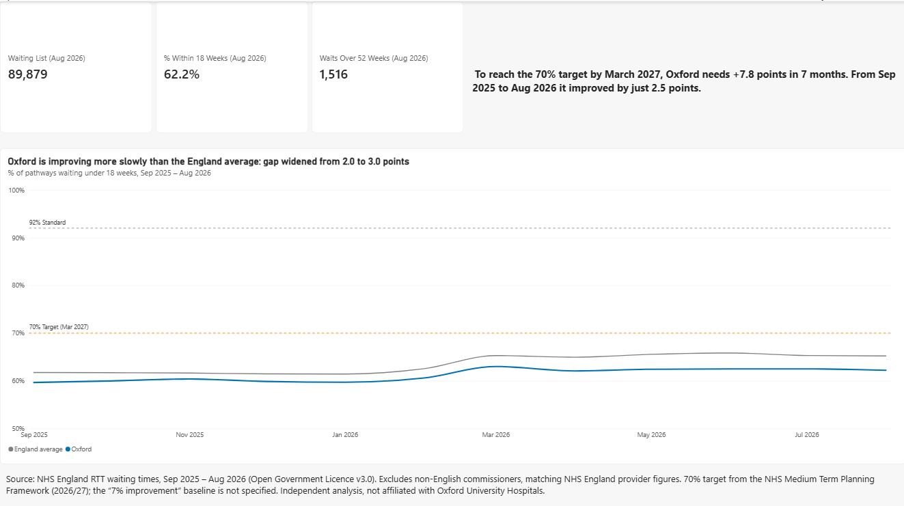
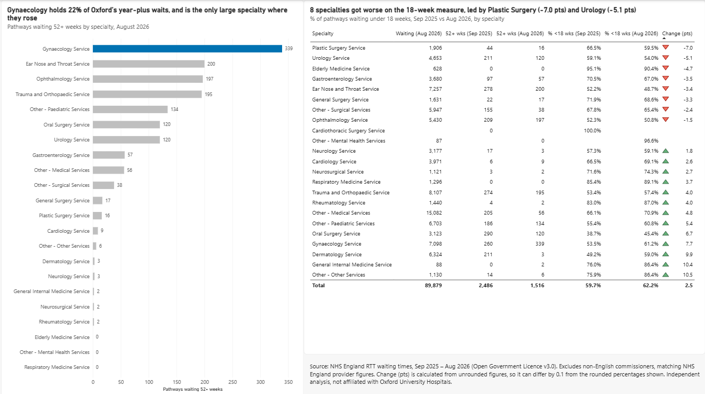
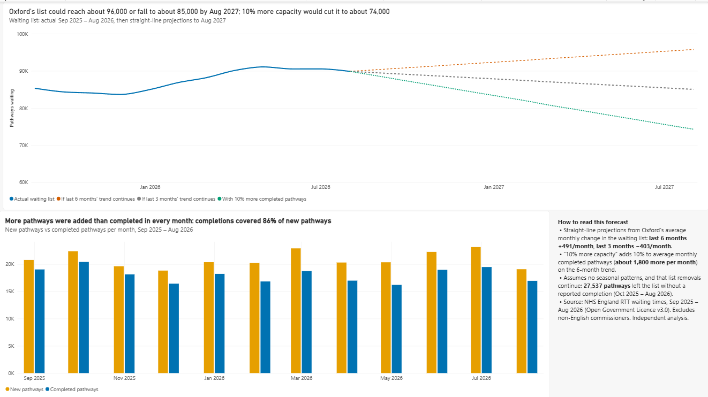

# Oxford University Hospitals: elective care performance dashboard

A Power BI performance pack and a short board-style report on referral to treatment (RTT) waiting times at Oxford University Hospitals NHS Foundation Trust, September 2025 to August 2026. Built from 2.18 million rows of NHS England data, processed in SQL Server.

*Independent analysis of public data. Not produced by, or affiliated with, the trust.*



## Key findings (August 2026)

- **62.2%** of Oxford's **89,879** waiting-list pathways had waited under 18 weeks. The national target is 70% by March 2027, and the constitutional standard is 92%. Reaching 70% needs a rise of 7.8 points in seven months; the previous 11 months saw a rise of 2.5 points.
- Oxford is **below the England average** (65.2%), and the gap widened from 2.0 to 3.0 percentage points over the year (2.1 to 3.0 against the rest of England, excluding Oxford).
- Waits over 52 weeks fell **39%** (2,486 to 1,516). **Gynaecology** holds 22% of them (339), and is the only large specialty where they rose (from 260).
- **Eight specialties** fell on the 18-week measure, led by Plastic surgery (−7.0 points) and Urology (−5.1).
- More pathways were added than completed in **every month**: completions covered 86% of new pathways. The list grew 5.3%, while the national planning framework expects lists to fall at every trust in 2026/27.
- Straight-line outlook to August 2027: about **85,000 to 96,000** pathways, or about **74,000** with 10% more completed pathways each month.

The full write-up is in [docs/performance_report_aug2026.pdf](docs/performance_report_aug2026.pdf).

## Business question

Oxford University Hospitals is missing the 18-week waiting time standard. The trust's elective care director (the intended audience) needs to know:

1. how the trust is performing against the 92% standard and the 70% target for March 2027, compared with England;
2. which specialties have the longest waits, and which are getting worse;
3. whether the waiting list is growing or shrinking, and where extra capacity would help most.

The project answers these with a monthly dashboard and three prioritised recommendations in the report.

## Dashboard

| Page | What it shows |
|---|---|
| **Performance overview** | August 2026 KPIs; Oxford vs the England average, % within 18 weeks over 12 months, with the 92% standard and 70% target |
| **Specialties** | Waits over 52 weeks by specialty; September 2025 vs August 2026 table, with ▲/▼ icons for the 18-week change. Clicking a specialty in the table highlights it in the chart. |
| **Forecast** | Actual waiting list, then three straight-line scenarios to August 2027; new vs completed pathways by month; assumptions |

| | |
|---|---|
|  |  |

## Method

1. **Data:** 12 monthly "Full CSV data file" extracts from NHS England (September 2025 to August 2026; revised files used for September 2025, December 2025 and March 2026): 2,180,679 rows, 121 columns.
2. **Load:** SQL Server 2025 Express. A staging table with every column as text, loaded with `BULK INSERT` (`FORMAT = 'CSV'`, so organisation names containing commas load correctly).
3. **Clean:** one clean table, `oxford_specialty_month` (1,390 rows: month × specialty × RTT part). The 105 week-band columns are summed with dynamic SQL (`STRING_AGG` over `sys.columns`), rather than typed by hand. Rules applied:
   - trust totals come from the `C_999` "Total" rows only, so specialties are never double counted;
   - `Part_2A` (waiting with a decision to admit) is a subset of `Part_2`, so it is never added to it;
   - non-English commissioners (`NONC`) are excluded, matching NHS England's published provider figures.
4. **Analyse:** CTEs, window functions (`LAG`) for monthly change and unreported removals, and conditional aggregation for period comparisons.
5. **Visualise:** Power BI Desktop (Import from SQL Server), DAX measures (`CALCULATE`, `DIVIDE`, `ISBLANK`), one model relationship, and a colour-blind-safe palette (Okabe–Ito).

## Validation

- Oxford's August 2026 figures match NHS England's official *Incomplete Provider* file exactly: 89,879 pathways; 55,907 within 18 weeks (62.2%); 1,516 over 52 weeks; and the specialty-level figures.
- For Oxford's waiting list, `Total All` equals the sum of all 105 week bands in all 12 months (difference 0).
- England, August 2026: 7,158,164 pathways (the same count as a public RTT project, before estimates for trusts that did not submit) and 65.2% within 18 weeks (matching NHS England's August press notice).
- England % within 18 weeks also matches published figures for March (65.3%) and June (65.8%). July (65.3%) matches the press notice's table that excludes estimates for the three trusts that did not submit.
- The waiting list reconciles: 85,326 + 229,356 added − 197,266 completed − 27,537 unreported removals = 89,879.
- England excluding Oxford differs from England by at most 0.1 points in any month.

## Data issues found and resolved

Full detail in [docs/cleaning_log.md](docs/cleaning_log.md).

| Issue | Resolution |
|---|---|
| `Total` column blank on waiting-list rows | Used `Total All`, which matches the published figure |
| Oxford total 61 pathways above the official file | Traced to non-English commissioners; excluded, now an exact match |
| England's list size not comparable month to month (different trusts missing each month) | Used NHS England's official change (−0.5%) for list size; percentages used as calculated |
| `Patients with unknown clock start date` blank | Treated as 0 with `ISNULL` |
| False changes of about ±100 points for specialties with no pathways in one of the two months compared | Blank result when either month is missing (`ISBLANK` guard) |

## Limitations

- Forecasts are straight-line projections, with no seasonal patterns, and assume list removals continue at recent rates.
- The trust-level target ("a minimum 7% improvement in 18-week performance or a minimum of 65%, whichever is greater") does not say whether 7% means percentage points or a relative change, or which month is the baseline. The dashboard therefore shows the 70% national target.
- Counts are pathways, not patients: some patients wait on more than one pathway.
- England percentages use submitted data only, without NHS England's estimates for trusts that did not submit.

## Repository contents

```
sql/         numbered T-SQL scripts, in the order they were run (08 is superseded by 17)
dashboard/   oxford_elective_dashboard.pbix and page screenshots
docs/        performance report (PDF), data dictionary, cleaning log
```

## How to reproduce

1. Download the 12 "Full CSV data file" extracts from NHS England's [RTT waiting times pages](https://www.england.nhs.uk/statistics/statistical-work-areas/rtt-waiting-times/).
2. In SQL Server, create a database called `RTT`, then run the scripts in `sql/` in order. Edit the file paths in the load script to match where you saved the CSVs.
3. Open the `.pbix` in Power BI Desktop, point the data source at your SQL Server (File → Options and settings → Data source settings), and refresh.

## Data source and licence

NHS England, *Consultant-led Referral to Treatment Waiting Times*, September 2025 to August 2026. Contains public sector information licensed under the [Open Government Licence v3.0](https://www.nationalarchives.gov.uk/doc/open-government-licence/version/3/). Targets from NHS England's [Medium Term Planning Framework 2026/27 to 2028/29](https://www.england.nhs.uk/long-read/medium-term-planning-framework-delivering-change-together-2026-27-to-2028-29/).

## Tools

SQL Server 2025 Express · SSMS 22 · T-SQL · Power BI Desktop · DAX · Excel

---

Nabil Nawaz Khan · [LinkedIn](https://www.linkedin.com/in/nabil-khan-0419781a3/)